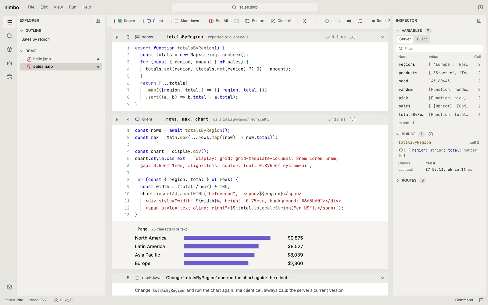
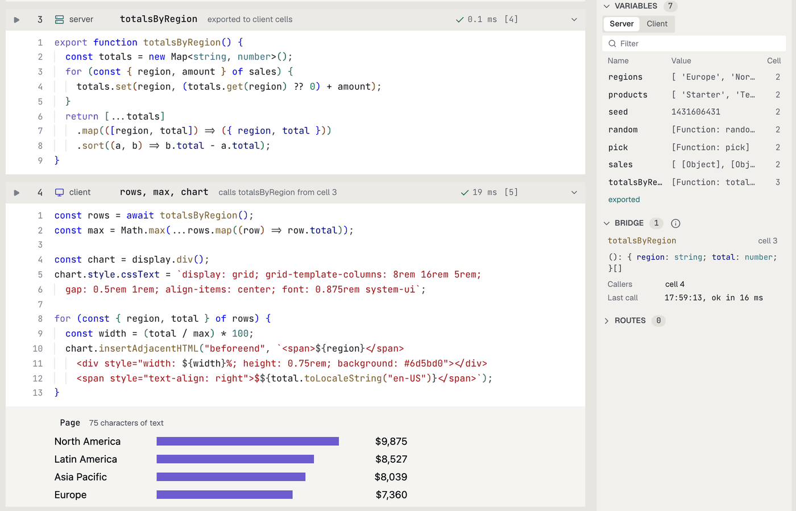
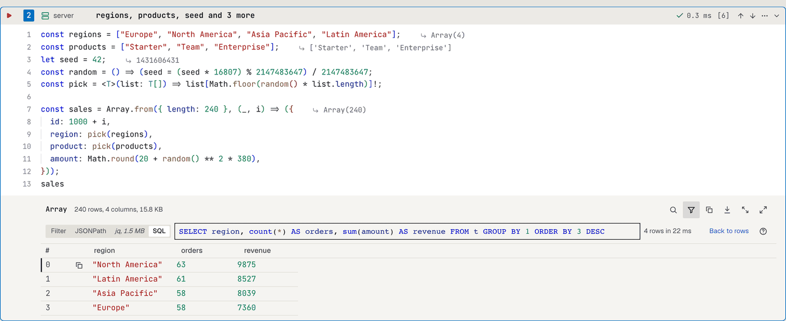
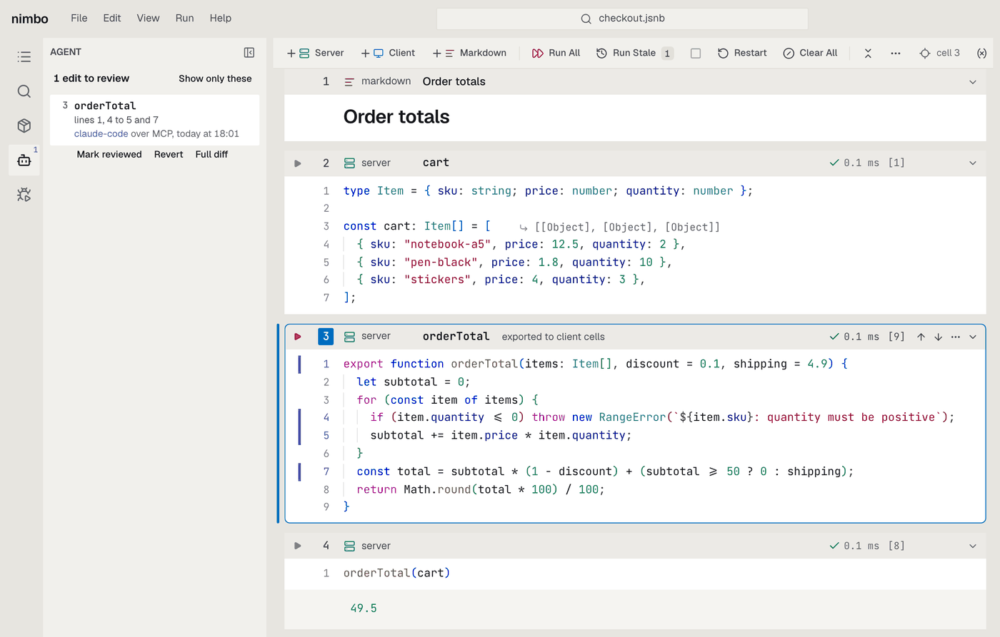
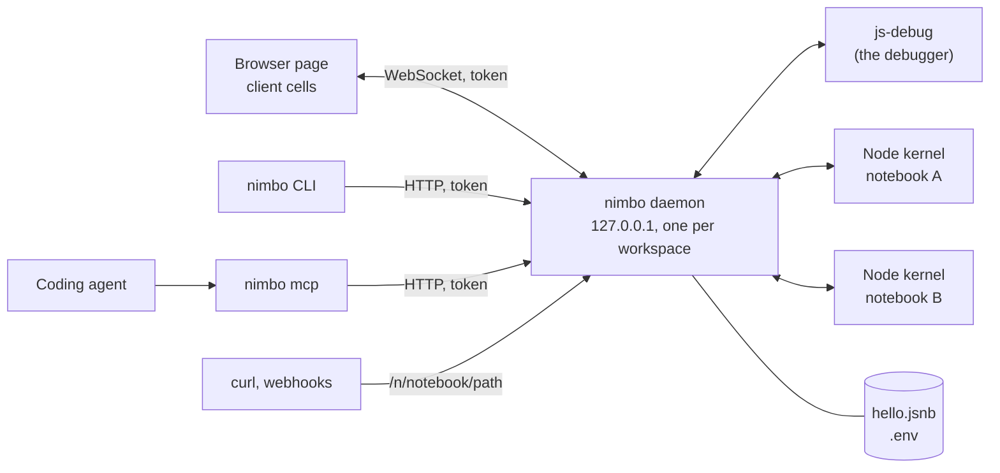

<div align="center">

<h1>nimbo: a Jupyter-style notebook for JavaScript and TypeScript</h1>

<p><strong>Server code and browser code live in the same notebook: server cells run in Node.js, client cells run in the page, and a client cell calls a server cell's functions with their types.</strong></p>

<p>
<a href="https://github.com/7sStudio/nimbo/releases/latest"></a>
<a href="https://github.com/7sStudio/nimbo/actions/workflows/release.yml"></a>
<a href="LICENSE"></a>


</p>

<p>
<a href="#install">Install</a> ·
<a href="#your-first-notebook">Tutorial</a> ·
<a href="#features">Features</a> ·
<a href="#use-it-with-your-coding-agent">Agents</a> ·
<a href="#cli-at-a-glance">CLI</a> ·
<a href="#how-it-works">How it works</a> ·
<a href="docs/00-overview.md">Docs</a>
</p>

</div>


<details>
<summary>The cards as text</summary>

- **Server and browser. One notebook.** Client cells in the page call what server cells in Node export, with their
  types.
- **Ask your data.** Tree, grid or raw, and a query bar for JSONPath, jq and SQL on DuckDB.
- **A cell is an endpoint.** `route()` answers real HTTP.
- **Typed across cells.** Hover, completion, rename.
- **Step through server cells.** Breakpoints, conditions, logpoints, variables and watch, from the page, the CLI or MCP.
- **Dark. Light.** Both themes, and several code colour themes.
- **Secrets stay secret.** From `.env`, shown as `***`.
- **One line to install.** Brings its own Node 26. `upgrade`, `doctor` and `uninstall` built in.
- **Built for agents.** Every action is a CLI command and an MCP tool. Their edits wait for your review.
- **Keyboard first.** VS Code and Jupyter keys, and a shortcuts editor.
- **Stale, never re-run.** Run Stale catches up.
- **Any npm package.** A missing import offers to install it.
- **Diffs cell by cell.** `.jsnb` is plain text. Export to HTML.
- **Local. No telemetry.** A token per workspace, no account. Apache-2.0.

</details>

nimbo is a local notebook. **Server cells** run in a Node kernel, **client cells** run in the browser page and draw
UI, and a client cell calls any function a server cell exports as if it were local, with its TypeScript types. The
same notebook is driven from the page, from the `nimbo` command line and from an MCP server, so your coding agent can
work in it beside you.

If you are looking for a Jupyter notebook for JavaScript, TypeScript or Node.js, nimbo works the way you expect:
cells, a kernel that keeps its state, rich outputs, Markdown, Shift+Enter to run. It adds the browser as a second
place to run code, a typed bridge between the two, and a plain-text file that diffs well.

## Contents

- [Why nimbo](#why-nimbo)
- [Install](#install)
- [Your first notebook](#your-first-notebook)
- [Features](#features)
  - [Write](#write)
  - [Run](#run)
  - [Explore data](#explore-data)
  - [Build UIs](#build-uis)
  - [Debug](#debug)
  - [Work with agents](#work-with-agents)
  - [Version control](#version-control)
  - [Keyboard and workspace](#keyboard-and-workspace)
- [Use it with your coding agent](#use-it-with-your-coding-agent)
- [Examples](#examples)
- [CLI at a glance](#cli-at-a-glance)
- [How it works](#how-it-works)
- [Security and privacy](#security-and-privacy)
- [Status and roadmap](#status-and-roadmap)
- [Update and uninstall](#update-and-uninstall)
- [Requirements](#requirements)
- [Building from source](#building-from-source)
- [Contributing](#contributing)
- [Licence](#licence)

## Why nimbo

- **Backend and frontend in one file.** Export a function from a server cell and call it from a client cell; the call
  crosses a typed bridge and your secrets stay on the server.
- **TypeScript that knows the whole notebook.** Completion, hover, diagnostics and rename work across cells and
  across the bridge, against your real `node_modules`, and a built-in debugger steps through server cells, and through client cells
  run headless.
- **Look at data, then ask it questions.** Every result opens as a tree, a grid or raw JSON, and a query bar runs
  JSONPath, jq or SQL (DuckDB) on it.
- **Serve it.** `route("POST /webhook", handler)` turns a cell into an HTTP endpoint you can `curl` or point a webhook
  at.
- **Built for agents too.** Everything the page does is a CLI command and an MCP tool, and an agent's edits are marked
  for you to review or revert.

## Install

```sh
curl -fsSL https://github.com/7sStudio/nimbo/releases/latest/download/install.sh | sh
```

The installer puts nimbo and its own Node 26 in `~/.local/share/nimbo` and the `nimbo` command in `~/.local/bin`,
adding that folder to your shell's `PATH` if needed (`--no-modify-path` skips it). It runs on macOS and Linux, arm64
and x64, as your own user, no `sudo`. Check the result with:

```sh
nimbo doctor
```

Two optional steps:

```sh
nimbo mcp install   # register the MCP server with your coding agents
nimbo sql install   # DuckDB for SQL from the CLI and agents, about 40 MB
```

`mcp install` sets up Claude Code and VS Code when it finds them and prints the entry for other agents. SQL in the
page needs no install.

With Homebrew instead:

```sh
brew install 7sStudio/nimbo/nimbo
```

Windows is not supported yet.

## Your first notebook

A few minutes, from an empty folder to a notebook with a typed bridge, a query and an HTTP endpoint.

**1. Open a notebook.**

```sh
mkdir hello && cd hello
nimbo open hello.jsnb
```

nimbo runs in this terminal until you press Ctrl+C, creates `hello.jsnb` and opens it in your browser. Any folder can
be a workspace.

**2. Add data on the server.** Click **+ Server** in the toolbar, paste this and press Shift+Enter:

```ts
const orders = [
  { id: 1, customer: "Ada", total: 42.5, status: "paid" },
  { id: 2, customer: "Grace", total: 18, status: "refunded" },
  { id: 3, customer: "Linus", total: 99.9, status: "paid" },
  { id: 4, customer: "Ada", total: 12.25, status: "pending" },
];
orders;
```

The last expression is the cell's result: four rows in a grid. `orders` now lives in the kernel, and every later
server cell can use it.

**3. Export a function.** Add a second server cell and run it:

```ts
export function revenue(status: string) {
  const matching = orders.filter((order) => order.status === status);
  const total = matching.reduce((sum, order) => sum + order.total, 0);
  return { status, count: matching.length, total };
}
```

`export` is what makes `revenue` callable from the page.

**4. Call it from the browser.** Click **+ Client** and run:

```ts
const paid = await revenue("paid");
display.div().innerHTML = `<b>${paid.count}</b> paid orders, <b>${paid.total} €</b>`;
paid;
```

This cell runs in the browser tab, `revenue` runs in Node, and the result comes back as plain data. Under the cell you
get the HTML it drew, **2 paid orders, 142.4 €**, and the value `{ status: "paid", count: 2, total: 142.4 }`. The editor
knows `paid`'s type, and the Inspector's Bridge section shows the call.

**5. Query a result.** Hover the first cell's result, click **Query** (the funnel), pick **jq** and press Enter on:

```jq
map(select(.status == "paid")) | map(.customer)
```

It answers `["Ada", "Linus"]`. Pick **SQL** instead; the result is the table `t`:

```sql
SELECT status, count(*) AS orders, sum(total) AS total FROM t GROUP BY status ORDER BY total DESC
```

```text
status    orders  total
paid      2       142.4
refunded  1       18
pending   1       12.25
```

The same queries work from a second terminal, for scripts and agents: `nimbo ls` lists the cell ids, then
`nimbo outputs <cell-id> --jq '…'` or `--sql '…'`.

**6. Add a package and serve an endpoint.** Add a server cell:

```ts
import { z } from "zod";

const NewOrder = z.object({ customer: z.string(), total: z.number().positive() });

route("GET /orders", () => orders);
route("POST /orders", async (req) => {
  const order = { id: orders.length + 1, status: "pending", ...NewOrder.parse(await req.json()) };
  orders.push(order);
  return order;
});
routeUrl("/orders");
```

Run it. `zod` is not installed yet, so the cell stops and offers **Install** (`nimbo add zod` does the same from a
terminal). Install it and run the cell again: its result is the endpoint's address, such as
`http://127.0.0.1:63195/n/hello/orders`.

**7. Call it.**

```sh
curl -s http://127.0.0.1:63195/n/hello/orders \
  -H 'content-type: application/json' -d '{"customer":"Alan","total":30}'
```

```json
{ "id": 5, "status": "pending", "customer": "Alan", "total": 30 }
```

Use the address your cell shows (the port is picked at start). Each request appears under the cell with its status and
time; a body that fails the schema answers 500 with zod's message. The route and `revenue` share the kernel's
`orders`, so `revenue("pending")` now counts two orders.

Where next: run `nimbo` with no arguments to open Home, then open one of the [examples](#examples).

## Features

<picture>
  <source media="(prefers-color-scheme: dark)" srcset="docs/assets/readme/hero-dark.png">
  
</picture>

### Write

- **Server cells** run in a long-lived Node 26 kernel, one per notebook: top-level `await`, and names stay defined from
  cell to cell.
- **Client cells** run in the page with `document`, `window` and every browser API; `display.div()` gives each cell a
  container that is emptied when it runs again.
- **Markdown cells** for the prose, with a heading outline and sections that fold.
- **TypeScript everywhere**, with a language service: completion, hover, signature help, go to definition,
  diagnostics and rename across cells and across the bridge (`nimbo check`, `nimbo language rename`).
- **npm packages** in both kinds of cells: a missing import offers Install, or `nimbo add <pkg>`; the page gets client
  packages bundled from your workspace's `node_modules`.
- **Secrets** in the workspace's `.env`: `env.STRIPE_SECRET_KEY` in a server cell, redacted from every output, log and
  bridge result. Client cells see only `PUBLIC_*` and `*_PUBLISHABLE_KEY` names.

### Run

- Run a cell, all, everything above, a cell and its dependents, or only the stale ones; interrupt and restart the
  kernel.
- A dependency graph marks the cells whose inputs changed as **stale**; nothing re-runs behind your back unless
  `execution.autoRunDependents` is on: then a cell's run re-runs its stale dependents, except cells marked manual.
- The **bridge**: exported functions become async calls from client cells, exported values arrive as copies, and
  anything that cannot cross (a class instance, a live client) is refused with an error naming it.
- **Push events**: `emit("progress", data)` in a server cell reaches `on("progress", (data) => …)` in a client
  cell, live, for progress bars and dashboards fed by a loop or a timer.
- **HTTP routes** with standard `Request` and `Response`, served at `/n/<notebook>/<path>`; every request is logged
  under its cell and in the Activity log.
- Reload or leave the page and come back: the kernel keeps its state and the outputs stay; run client cells again to rebuild what they drew. Notebooks autosave.



### Explore data

- One viewer for every result: **tree**, **grid** and **raw** views, search, copy as JSON, JavaScript or CSV, export
  to JSON, NDJSON, CSV or HTML, full screen.
- A **query bar** with filter chips, **JSONPath**, **jq** and **SQL**. SQL runs on DuckDB in the page, loaded on
  first use; pin a query to keep it on the cell.
- Large values stay usable: the page receives the first part, the daemon keeps the whole value for queries and
  downloads.
- The **Inspector** lists every name the server and the page define, with the cell that defined it.



### Build UIs

- Plain DOM, **Vue 3** (`import { createApp } from "vue"`, with `template` strings) or any browser library from npm.
- Timers, listeners and routes a cell registers are cleaned up when it runs again (`dispose(fn)` for your own).
- `display.iframe()` when a cell wants full isolation from the page.

### Debug

- A debugger for server cells: breakpoints (F9), Ctrl+Shift+F5 to run a cell under it, conditions, hit counts and logpoints; step over, into and out; the
  call stack, variables, watch expressions and a debug console.
- Client cells too, when they run in the headless page (`realm.headless` on, no tab holding the notebook): the same
  breakpoints, steps, stack, variables and evaluations, from the CLI and MCP; `debug.state` says which side paused.
- The same from the terminal and for agents: `nimbo debug set-breakpoint`, `stack`, `scope`, `evaluate`, `resume`,
  and the matching MCP tools.
- Errors come back with stacks mapped to your cell's lines; while your tab runs the client cells, a client cell's
  breakpoint becomes a `debugger;` statement for the browser's DevTools.

 5) inside orderTotal; the Variables section shows item, subtotal 25 and discount 0.1, the Watch section evaluates subtotal + line to 43, and the call stack lists orderTotal and cell 4." src="docs/assets/readme/debugger-paused-at-breakpoint.png">

### Work with agents

- Every operation is a command in one registry, exposed as a `nimbo` subcommand and an MCP tool: add, edit, move and
  run cells, read outputs as JSON, query them, type-check, rename, install packages, debug, diff and commit.
- Each cell records who edited it last. An agent's edit that you have not reviewed keeps the code it replaced, marks
  the changed lines and offers **Mark reviewed**, **Revert** and **Full diff**; the Agent view lists them all.
- You watch the agent's cells appear and run live in the page.
- An agent reads what a client cell renders: `nimbo cell snapshot <cell>` (MCP `cell_snapshot`) answers its visible
  text, its sanitised HTML with `--html`, and a PNG of it with `--image` from the headless realm.
- An agent working alone runs client cells too: with `nimbo config set realm.headless true`, a client cell with no tab
  open runs in your own Chrome, Chromium or Edge, headless, with a fresh profile, its sandbox on and no debugging
  port; push events reach it, and when you open the notebook your tab takes over.



### Version control

- A `.jsnb` file is JSON with each cell's source as a list of lines and stable cell ids, so it diffs and merges well.
  Secrets are never in it; outputs only if you turn on `outputs.save`.
- A **Source Control** view (status, stage, unstage, discard, commit and amend) and a rendered notebook diff, cell by
  cell; fetch, pull, push, publish and sync with your own git credentials and pull strategy, branches, stash, and the
  history of the branch or of one notebook with its diff at any commit. What can lose work asks first.
- `nimbo diff` prints the same diff in the terminal; `nimbo export page.html` writes the notebook as one HTML page.

### Keyboard and workspace

- VS Code's keys (Cmd+Shift+P, Cmd+Enter, Shift+Enter, F9, and F5 while paused) and Jupyter's command-mode keys (A, B, D D, Shift+S
  for a server cell, Shift+C for a client cell), with a Keyboard Shortcuts editor (Cmd+K Cmd+S).
- Drag cells to reorder them, give them titles, fold them, and collapse a heading's whole section.
- Light and dark themes, several code colour themes, and settings at user and workspace scope, as in VS Code (a
  Settings page, or `nimbo config`).
- **Home** lists the workspace's notebooks with search and a preview, and opens the examples.

## Use it with your coding agent

Register the MCP server once:

```sh
nimbo mcp install
```

It adds nimbo to Claude Code (user scope) and VS Code when they are installed, and prints the JSON entry for Claude
Desktop, Cursor and other MCP clients. The server works on the workspace of the folder the agent runs in, and starts
nimbo when a tool needs it. Agents that prefer a shell can use the `nimbo` CLI directly: every command takes `--json`.

To add it by hand instead, the server is the command `nimbo mcp` over stdio:

```sh
claude mcp add --scope user nimbo -- nimbo mcp     # Claude Code
```

```json
{
  "mcpServers": {
    "nimbo": { "command": "nimbo", "args": ["mcp"] }
  }
}
```

The JSON form goes in Claude Desktop's `claude_desktop_config.json`, Cursor's `~/.cursor/mcp.json` or any client that
reads `mcpServers`. `nimbo mcp install --print` prints these with the full path of your install, and
`nimbo uninstall` removes the entries it added.

nimbo is also listed in the [MCP Registry](https://registry.modelcontextprotocol.io) as `io.github.7sStudio/nimbo`,
as an MCP bundle, `nimbo-mcp-<version>.mcpb`, attached to each release: a client that installs from the registry, or
Claude Desktop when you open the file, sets it up in one step. The bundle runs the nimbo installed on your machine, in
the workspace folder you choose when you add it; it does not install nimbo itself, so install nimbo first.

Then ask, for example:

> Open `sales.jsnb`, add a server cell that groups the orders by month, and show me the three best months with SQL.

> The last cell of `checkout.jsnb` returns the wrong total. Set a breakpoint in `orderTotal`, run it and tell me
> what `subtotal` is on each item.

> Run every stale cell in `report.jsnb`, then list the cells that still fail and why.

The agent reads and writes cells, runs them and gets the outputs as JSON, never by scraping the page. Its edits show
in the page as they happen, marked with its name for you to review. Client cells run in the browser, so they need the
notebook open in a tab, or the setting `realm.headless` on, which runs them in a headless Chrome on your machine.

## Examples

Five notebooks ship with nimbo. Open one from Home (**Examples**), or copy it into the workspace from a terminal:

```sh
nimbo examples copy --name 01-data && nimbo open 01-data.jsnb
```

| Example                | What it shows                                                                                                        |
| ---------------------- | -------------------------------------------------------------------------------------------------------------------- |
| `01-data`              | 3,000 generated orders through the tree, the grid, raw JSON, JSONPath, jq and SQL                                    |
| `02-client-ui`         | A small interface in client cells: drawing, events, shared state and a timer that cleans up                          |
| `03-payments`          | A Stripe payment end to end: a server cell, a webhook route and a client cell (works without keys, with sample data) |
| `04-routes-and-agents` | A small HTTP API called with `curl`, the Activity log, failures, and an agent's edit to review                       |
| `05-vue`               | Vue 3 components, state shared across cells and a server function called from a component                            |

## CLI at a glance

| Command                                             | What it does                                                     |
| --------------------------------------------------- | ---------------------------------------------------------------- |
| `nimbo`                                             | Open Home, the list of the workspace's notebooks                 |
| `nimbo open [file.jsnb]`                            | Open a notebook, creating it if needed; runs nimbo until Ctrl+C  |
| `nimbo ls`                                          | The cells: id, type, status, stale, who edited it                |
| `nimbo cell add --type server --source '…' --run`   | Add a cell and run it                                            |
| `nimbo run <cell>` · `--all` · `--stale`            | Run cells and print their outputs                                |
| `nimbo outputs <cell> --sql '…'`                    | Query an output (`--jq`, `--query` for JSONPath, `--format csv`) |
| `nimbo check`                                       | Type errors, without running anything                            |
| `nimbo add <package>`                               | Install npm packages into the workspace                          |
| `nimbo debug set-breakpoint --cell <id> --line <n>` | Debug a cell (`stack`, `scope`, `evaluate`, `resume`, …)         |
| `nimbo diff`                                        | What git sees, notebooks cell by cell                            |
| `nimbo git pull`                                    | Git from the CLI (`push`, `switch`, `stash`, `log`; `--yes`)     |
| `nimbo export page.html`                            | The notebook as one HTML page                                    |
| `nimbo config set ui.theme dark`                    | Change a setting (`--user` or `--workspace`)                     |
| `nimbo stop`                                        | Stop nimbo for this workspace                                    |

`nimbo --help` lists everything; `nimbo <command> --help` gives each one's flags. The CLI reference is in
[packages/cli/README.md](packages/cli/README.md) and the MCP server's in [packages/mcp/README.md](packages/mcp/README.md).

## How it works

- `nimbo open` starts one **daemon** per workspace folder, listening on 127.0.0.1 with a token.
- Each open notebook gets its own **Node kernel**, a child process: a runaway loop never freezes the daemon, Interrupt
  keeps the kernel's state, Restart starts a fresh one.
- The **page** is a client of the daemon and runs the client cells. The CLI and the MCP server are clients too; all
  three go through one registry of commands, so none can do what the others cannot.
- A client cell's call to a server function goes page → daemon → kernel and back, its arguments and result copied and
  the result redacted on the way.
- The **`.jsnb`** file is plain JSON next to your code; secrets live in `.env`.



The specification lives in [docs/](docs/00-overview.md): [architecture](docs/02-architecture.md), API, kernel, bridge, file format, code standards, testing and queries.

## Security and privacy

- nimbo listens on 127.0.0.1 only. Its API needs the workspace's token and checks the `Host` and `Origin` headers;
  the page's address carries the token.
- Routes under `/n/<notebook>/…` answer without a token, so that webhook senders can reach them. They are still on
  127.0.0.1 unless you forward them yourself (for example with `stripe listen`).
- Secrets stay in `.env`, out of the notebook file, and are redacted from outputs, logs and bridge results.
- No telemetry and no account. nimbo goes online only when you ask it to: installing a package, `nimbo upgrade`,
  `nimbo sql install`. Your cells, of course, do whatever their code does.
- A notebook runs code with your permissions. Open only notebooks you trust, and review what an agent changed.

## Status and roadmap

nimbo is early: 0.1 is its first public release. The kernel, the bridge, routes, the output viewer and its query
engines, the CLI, the MCP server, the debugger and source control are built and tested against the real
components (the built kernel, jq, DuckDB in Node and in Chromium). Expect rough edges in the UI and changes before
1.0.

Known limits today:

- nimbo's debugger stops in client cells only in the headless page; while your tab holds the notebook, client-cell
  breakpoints go to the browser's DevTools, and you cannot watch a headless debug session in a tab yet.
- Vue works with `template` strings or `h()`; no `.vue` files and no JSX.

Planned, not yet available:

- A tutorial mode that walks a new user through the concepts
- Add-ons, starting with a Stripe add-on (webhook forwarding, signature checks, a request log)
- A desktop app
- Windows support

The full list is in [docs/12-roadmap.md](docs/12-roadmap.md).

## Update and uninstall

```sh
nimbo upgrade      # the latest release, installed beside this one; --check only reports
nimbo uninstall    # nimbo, its Node and its DuckDB; --purge also your settings
```

Neither touches your notebooks. Both apply to installs made with the installer script; a Homebrew install will be
updated and removed with `brew`.

## Requirements

- macOS or Linux, arm64 or x64. nimbo brings its own Node 26 and npm.
- A current Chromium-based browser, Firefox or Safari, on a laptop or desktop screen.
- Git, for the Source Control view and `nimbo diff`.

## Building from source

For contributors. You need Node 26 (`.nvmrc`) and pnpm 12.10.1.

```sh
pnpm install
pnpm build
alias nimbo="node $PWD/packages/cli/dist/main.js"
```

After a change under `packages/ui`, `pnpm --filter @jsnb/ui build` and a reload of the tab are enough; any other
package needs `pnpm build` and a restart of nimbo. [CONTRIBUTING.md](CONTRIBUTING.md) has the branch, commit and test
rules.

## Contributing

Issues are welcome: bugs with the steps to reproduce them, rough edges you hit, and features you miss. For a larger
change, open an issue first so we can agree on the shape. See [CONTRIBUTING.md](CONTRIBUTING.md).

## Licence

Apache License 2.0. Copyright 2026 7sStudio. See [LICENSE](LICENSE) and [NOTICE](NOTICE).

Jupyter is a trademark of LF Charities; nimbo is not affiliated with Project Jupyter.
