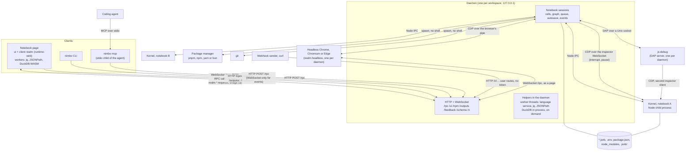
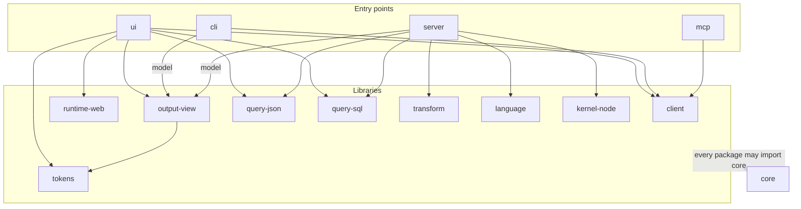
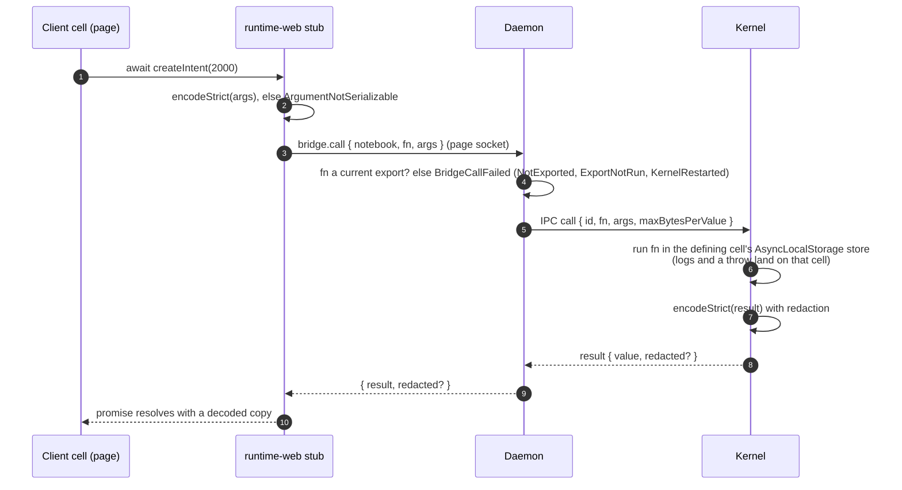
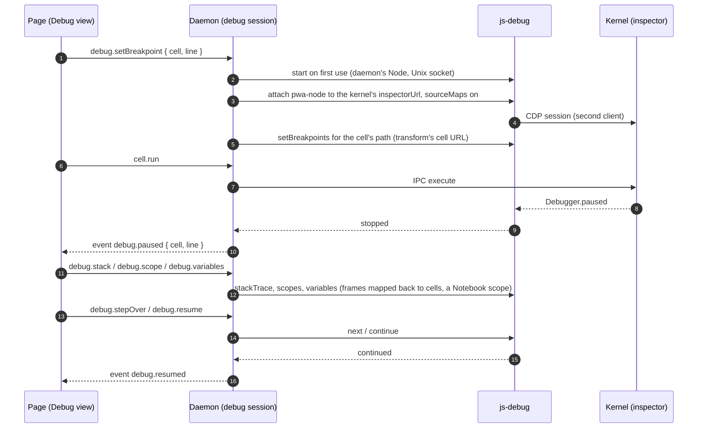

# 02 · Architecture

How nimbo fits together: the processes and their channels, the packages and what each may import, the contracts between parts, the main flows step by step, where state lives, and how the product is built and shipped. Details belong to the documents listed in [00-overview.md](00-overview.md) §10; this one links to them.

---

## 1. The system in one picture

- One **daemon** per workspace folder (`packages/server`) owns everything: the notebooks, their run history, the event stream, the files. It listens on `127.0.0.1` only, behind a token.
- One **kernel** per open notebook (`packages/kernel-node`), a Node child process of the daemon, runs the server cells and keeps their scope. The daemon reaches it over Node IPC and over its inspector.
- The **page** (`packages/ui`) is a client of the daemon and is also the **client realm** (`packages/runtime-web`) where client cells run. One WebSocket carries its commands, its events and the daemon's requests to the realm.
- The **CLI** (`nimbo`) and the **MCP server** (`nimbo mcp`) are clients too. Every client speaks the same command registry (`packages/core`), so none can do what the others cannot.
- The daemon starts helpers on demand: **js-debug** for the debugger, the user's **package manager**, **git**, worker threads for the language service and the JSON query engines, and, with `realm.headless` on, a **headless browser** (the system's Chrome, Chromium or Edge) whose page is the client realm of a notebook no tab holds.
- Disk: the `.jsnb` notebooks, `.env`, `package.json` and `node_modules/` of the workspace, the daemon's `.jsnb/` folder, and the user's settings folder.

Four kinds of long-lived process belong to nimbo: the daemon, its kernels, js-debug and the headless browser. The page lives as long as its tab. The CLI is short-lived; the MCP server lives for the agent's session. Agents and humans never talk to a kernel directly: everything goes through the daemon.

## 2. Packages and their dependencies

This section is the authority on packages and on which package may import which. `core` is the shared vocabulary (types, Zod schemas, the registry, `JsnbError`) and every package may import it; the last column lists each package's imports of our packages beyond `core`.

| Package | Runs in | Owns | Imports (ours) |
|---|---|---|---|
| `core` | anywhere, pure | the notebook model and ids; the `.jsnb` format, its parser and migrations (07); the dependency graph and staleness over the transform's analysis (`analysis/`); output, event and error types; the command registry (03 §3); the settings schema and the default keybindings (`settings/`); the value serializer (04 §5.4, with the strict mode the bridge uses); the notebook diff (`diff/`); the product's name, version and data folder (`product.ts`) | — |
| `tokens` | anywhere, pure | the design tokens as data (palette in `oklch()` and hex for both themes, type, corners, motion, layers, syntax themes) and the two stylesheets generated from them, `page.css` and `viewer.css` | — |
| `transform` | anywhere, pure (the daemon calls it) | the cell compiler: type stripping, declaration and import rewrite, export collection, source maps (04 §3); `analyze(source)` (`defines`, `uses`, `exports`, `imports`, `kinds`) from the same binder, so the graph, the bridge and the rewrite agree | `core` |
| `language` | a worker thread of the daemon | the TypeScript language service of a notebook: one project per notebook with one service per realm, virtual files per cell, cross-cell and bridge types, notebook-aware diagnostics, completions, hover, signature help, definition, rename (§11.1) | `core` |
| `kernel-node` | the kernel child process; its `NodeKernel` half in the daemon | the server realm: `__scope`, execution, outputs and their limits, disposers, built-ins (`display`, `env`, `route`, `routeUrl`, `dispose`), redaction (04); the daemon's side of the kernel: the fork, the IPC protocol, the inspector session, interrupt, the process group | `core` |
| `runtime-web` | the page | the client realm: scope, execution, `display` and containers, the bridge layer (stubs and snapshots), disposers, the page's redaction (04 §4, 05) | `core` |
| `server` | the daemon | HTTP and WebSocket, authentication, command handlers, notebook sessions (cells, graph, queue, executions, autosave, external edits and conflicts, recovery copies, moves), events, kernel supervision, the client realm's daemon side and the bridge, the headless browser of the headless client realm, routes, the `/npm/` bundler, packages, secrets, settings and keybindings files, the debugger (js-debug), git, output queries, the HTML export, feedback, examples, logs | `core`, `transform`, `language`, `kernel-node`, `output-view` (its `model` only), `query-json`, `query-sql` |
| `client` | anywhere (page, CLI, MCP server) | the typed client generated from the registry (`src/generated.ts`), HTTP and WebSocket transports, retries and reconnects, event subscriptions | `core` |
| `output-view` | the page; its `model` also in Node | the output viewer: detection, views (tree, grid, raw, text, error, dom), search, filter chips, export, full screen, the renderer registry; `model/` (no DOM, no Vue) also gives the CLI's previews and the HTML export | `core`, `tokens` |
| `query-json` | the page and Node | JSONPath and jq behind `QueryEngine`, each in its own worker; filter chips compiled to JSONPath (11) | — |
| `query-sql` | the page (a Web Worker) and the daemon | SQL over records with DuckDB behind `SqlEngine`: DuckDB-WASM in the page, `@duckdb/node-api` in the daemon (11) | — |
| `ui` | the page | the Vue app: shell, cells, panels, overlays, Home, diff view, feedback layer, stores, commands, keyboard, theme; mounts `runtime-web` as the page's realm (§11.6) | `client`, `output-view`, `query-json`, `query-sql`, `runtime-web`, `tokens` |
| `cli` | a shell | `nimbo`: the shortcuts and one verb per public command (03 §8); finds or starts the daemon; install, upgrade, uninstall, doctor; renders outputs with `output-view`'s model | `client`, `output-view` (its `model` only) |
| `mcp` | a child of the agent, on stdio | `nimbo mcp`: one tool per public command, two resource templates (03 §9) | `client` |

- **Enforced** by `dependency-cruiser` (`.dependency-cruiser.cjs`, `pnpm depcruise`): one rule per package from the table above, no cycles, no orphan files, no relative import out of a package. `tools/boundaries.config.js` (eslint-plugin-boundaries) enforces the layers inside a package (08 §4).
- **Processes, not imports**: the CLI and the MCP server start the daemon by resolving `@jsnb/server/main` with `import.meta.resolve` and spawning it, the CLI finds the UI build through `@jsnb/ui/index.html` and starts `nimbo mcp` through `@jsnb/mcp/main`, and the daemon forks `kernel-node`'s `main.js` as the kernel (its `NodeKernel` half is an ordinary import). `cli` lists `server`, `ui` and `mcp`, and `mcp` lists `server`, as dependencies in `package.json` only so that they are installed beside it; no source of theirs imports them.
- `cli` and `mcp` may not import each other: `mcp/src/daemon/` repeats the CLI's way of finding and starting a daemon.
- A file that needs both Node and the DOM is in the wrong package.
- Outside the graph: the test host `tests/output-view` (the viewer with the real query engines; no package may import it), and the `tools/` workspaces `test-tools`, `test-daemon` and `style-gate`, which only tests, fixtures and a `vite.config.ts` may import (09 §8).

## 3. Contracts between parts

Every channel carries typed messages validated on arrival. Where the table says Zod, an invalid message is refused with a named error or logged and ignored, never acted on.

| From → to | Over | Carries | Validated by | Documented in |
|---|---|---|---|---|
| UI, CLI, MCP → daemon | JSON-RPC 2.0: WebSocket `/rpc` or `POST /rpc` | one `domain.verb` command per call; the registry is the only interface, the UI has no private operations | the command's Zod input and output schemas (`server/src/commands/bind.ts`); the four-surface contract test (09 §4.1) | 03 §1, §3, §7 |
| daemon → subscribers | JSON-RPC notifications on the WebSocket | events `{ notebook, seq, ts, type, data }`, `seq` per notebook | core's `Event` union | 03 §6, §4.2 below |
| daemon ↔ page realm | requests both ways on the page's one WebSocket | daemon → page `realm.execute`, `realm.reset`, `realm.interrupt`, `realm.snapshot`, `realm.event`, `realm.dispose`; page → daemon `realm.attach`, `realm.detach`, `realm.report`, `bridge.call` (internal commands) | Zod on both sides | 05 §9, 03 §4.5 |
| server realm ↔ client realm | through the daemon | only `export`ed plain data (copied) and `export`ed functions (async stubs); class instances and handles are refused with a named error; page → server only as call arguments | the serializer's strict mode, the error catalogue | 05 §1 to §7 |
| daemon ↔ kernel | Node IPC, `serialization: "advanced"` | daemon → kernel `execute`, `call`, `snapshot`, `bindings`, `route`, `dispose`, `cancel`, `page`, `shutdown`; kernel → daemon `ready`, `output`, `status`, `result`, `exports`, `routes`, `events` | Zod on both sides (`kernel-node/src/ipc/messages.ts`) | 04 §2.1 |
| daemon → headless browser | CDP over the browser's pipe (`--remote-debugging-pipe`, no TCP port), puppeteer-core | open, guard and close pages, set the page cookie, start the realm with the token, screenshots | puppeteer's protocol types | 03 §4.5, §7 below |
| daemon → kernel inspector | CDP over the inspector's WebSocket, `127.0.0.1`, random port | interrupt (`Runtime.evaluate` of the kernel's hook), `Debugger.enable`, resume | the `Kernel` interface in `core` | 04 §6, §9, §11 |
| daemon ↔ js-debug | DAP over a Unix socket in a `0700` folder | breakpoints, pause, steps, stack, scopes, variables, evaluate | `server/src/kernel/debug/dap.ts` | 03 §4.9, 04 §9 |
| js-debug → kernel | CDP, a second inspector client | the debugging session, with the transform's source maps | — | 04 §9 |
| page → daemon | HTTP `GET` | `/ui/` (the app), `/npm/<spec>` (ES modules for client cells), `/outputs/<execution>/<index>.json` (full values), `/feedback/`, `/schema/settings.json` | path rules per endpoint (§7.1) | 03 §7.1, §7.5 |
| outside → daemon → kernel | HTTP `/n/<name>/…`, then the `route` IPC message | a user route's request and answer | the daemon strips its own credentials both ways | 04 §8, 03 §7.1 |
| daemon → worker threads | `worker_threads` messages | language requests with a snapshot of the cells (`server/src/notebook/language/protocol.ts`); jq and JSONPath tasks | the protocol's types; one task at a time | §11.1, 11 |
| daemon → package manager, git | `spawn`, no shell, arguments after `--` | `add`/`remove` of packages; git reads and writes | refused names and paths before the call | 03 §4.6, §4.15 |
| daemon ↔ disk | atomic writes (temp, `fsync`, rename) | notebooks, settings, keybindings, `.env`, `server.json`, caches, logs | the format's schema on load, the hash of the last write before each write | 07 |
| kernel or page → anything | every string leaving it | outputs, snapshots, bridge results, logs, debugger values, reports | redaction at the boundary (§8) | 04 §10, 08 §5 |
| our chrome ↔ user output | the page's DOM | no global reset (Tailwind without Preflight); our styles under `.jsnb-ui` and `.jsnb-ov` | the Preflight isolation test | 08 §7 |
| CLI or MCP of one version ↔ daemon of another | the same API | `apiVersion` (1) from `workspace.info`, shown by `nimbo --version` and `nimbo status`; a result that fails its schema is a transport error naming it | the output schemas | 03 §1 |

## 4. Flows

A **notebook session** (`server/src/notebook/session/`) is the daemon's state for one open notebook: the cell store (each cell's record, status, last and previous run, analysis, stale flag), the header, the autosaver, the kernel supervisor, the retained full values, the run queue with auto-run, the client realm's state, the debug session and the query engines (`context.ts`, `assemble.ts`). `notebook.open` creates it and starts the kernel at once; a second open returns the same session; `notebook.close` stops the debugger, flushes the autosave, detaches the realm, stops the queue and the kernel, frees retained values and the SQL engine, and emits `notebook.closed`.

### 4.1 A command, from any client

1. The client calls `client.<domain>.<verb>(input)` (generated) or `client.call(descriptor, input)` [client].
2. The call travels as JSON-RPC: the UI over its one WebSocket, the CLI and the MCP server as one `POST /rpc` per call. The connection declares its client (`?client=ui|cli|mcp|file&agent=` on the upgrade, `X-Jsnb-Client` and `X-Jsnb-Agent` on HTTP) [client → server].
3. The daemon checks `Host`, `Origin` and the token (§8), finds the bound command (`-32601` when none, `NOT_AVAILABLE` for a `planned` one), parses the input with its Zod schema (`INVALID_PARAMS` with the issues) [server/http, server/commands].
4. The handler is thin: act on the session or the workspace, emit events, return. Mutations schedule an autosave; commands that execute code go to the queue and the kernel or the page [server/notebook].
5. The result is checked against the output schema (a mismatch is an internal error, logged) and returned; the client parses it again [server → client].

### 4.2 The event stream and the UI mirror

Every mutation and every step of a run produces an event `{ notebook, seq, ts, type, data }` (03 §6); `seq` counts per notebook for the daemon's life, and the workspace stream (`notebook: ""`) has its own. A subscriber calls `events.subscribe` (WebSocket only) and receives the current `seq`, calls `notebook.get`, then applies every event with a higher `seq` in order; a gap, a malformed envelope or a reconnect re-hydrates with `notebook.get` (`client/src/events/`). The UI's notebook store is a pure reducer over these events (`ui/src/store/mirror.ts`, `reduce.ts`, `sync.ts`): the page holds nothing about the notebook that the daemon does not have, which makes reloads, redirect flows and agent edits safe.

### 4.3 A bridge call

A client cell calls a function a server cell `export`ed.

- Calls are not queued behind cell runs; the kernel refuses a call (`CallRefused`) while the export's cell is re-running.
- `bridge.rpcTimeoutMs` applies on both sides (`RpcTimeout`); time the kernel spends paused in the debugger does not count.
- `kernel.interrupt` stops a server function a call is running; the awaiting client cell ends `interrupted` (§5).
- Push events: a server cell's `emit(name, data)` goes to the kernel's bounded queue, then to the daemon's, then to the page as `realm.event` batches, one at a time, where `on(name, callback)` listeners hear them; with no page attached they are counted and dropped, and `bridge.events` counts them by name (05 §6).
- Snapshot: `cell.snapshot` asks the page holding the realm for a client cell's rendered container, as text and, on request, as HTML passed through an allowlist (no script, style, handler or remote load), each cut to `maxBytes`; the page loads that code on the first request, and what it answers is the page's own writing, untrusted (`runtime-web/src/display/agentSnapshot.ts`, `server/src/notebook/realm/snapshot.ts`); with `image`, the daemon screenshots the container in its headless page (`server/src/kernel/headless/page.ts`).

### 4.4 Save, autosave and conflict

1. A mutating command marks the session dirty; a load, a reload or a format migration does not, so the file is written only after an edit, a run whose outputs are saved, or `notebook.save`. The autosave policy is the setting `files.autoSave`: `afterDelay` (default, 1 s after changes pause, at most 10 s after a burst starts), `onFocusChange`, `interval`, or `off` (07 §5).
2. The document is serialized deterministically and written atomically: an exclusive temp file beside it, `fsync`, rename, mode kept (`server/src/files/atomicWrite.ts`), then `notebook.saved`.
3. Before every write the daemon compares the file on disk with the SHA-256 of its last read or write. A mismatch merges the file's edit first (below); with merging off it writes nothing, emits `notebook.conflict` once and suspends autosave; the notebook stays runnable.
4. The user or agent resolves it with `notebook.reload` (reconcile by cell id: kept cells keep their status and runs) or `notebook.save { force: true }`.
5. A failed write emits `notebook.saveFailed` and retries at the next mutation and every 10 s.

The other direction: a watch on each open notebook's file (`session/watch.ts`) merges another program's edits into the session by cell id against the last text written or read (`session/external.ts`, core's `mergeCells`), writing back only for unsaved edits that stay on top; the same cell changed on both sides is held as that conflict, its session text kept in a recovery copy in `.jsnb/recovery/` (07 §5, §7). A git operation that rewrites the working tree (pull, switch, stash, abort, discard) holds the open notebooks' writes while git works, then runs the same merge (`git/tree.ts`). The daemon follows a notebook moved or renamed on disk (by device and inode, every 2 s, `workspace/moves.ts`).

### 4.5 Open and start

1. `nimbo open [path]` (or bare `nimbo` at a terminal) finds the workspace: the nearest ancestor of the working folder with a `.jsnb/`, else the working folder [cli].
2. It reads `.jsnb/server.json` (`{ pid, port, token, startedAt, version, root }`, `0600`) and checks the daemon is alive: the pid exists, `workspace.info` answers within 2 s with the same `startedAt`, and `root` is this workspace's real path. A daemon of another folder is `DaemonForeign`.
3. With none running, the CLI spawns its own Node on the daemon's entry (`@jsnb/server/main`, or `NIMBO_DAEMON_ENTRY`) with `--workspace`, `--foreground` and `--ui <build>` (`NIMBO_UI_DIR`), in its own process group, forwarding `SIGINT`, `SIGTERM` and `SIGHUP` to it [cli/daemon].
4. The daemon prepares `.jsnb/`, refuses a second daemon for the folder, binds `127.0.0.1` on a free port, makes a new token and page key, writes `server.json`, and prints one `{ "event": "listening", … }` line [server].
5. The CLI calls `notebook.open`, or `notebook.create` when the file does not exist, then hands `/ui/<name>?token=…` to the platform's opener (Home, `/ui/?token=…`, when there is no notebook to open).
6. The page loads: the first `/ui/` request with `?token=` sets the page cookie; the app connects its WebSocket with the token from its address, subscribes, hydrates, and attaches as the notebook's realm (§5) [ui].
7. The daemon runs until Ctrl-C (a second one forces), `nimbo stop`, `workspace.stop`, a signal, or its folder being moved or deleted. With one already running, `nimbo open` uses it and returns; `--background` starts it detached and returns.

### 4.6 An agent's edit through MCP

1. The agent calls a tool such as `cell_update` (a registry command, `.` written `_`) over stdio [mcp].
2. The MCP server finds the workspace from its working folder and reads `server.json`. A mutating tool starts the daemon when none runs (detached, as the CLI's `--background`, with the same `--ui` build, `@jsnb/client/node` computing it for both); a read-only tool does not.
3. The call goes as one `POST /rpc` declaring `client=mcp` and the agent's name from MCP `initialize`.
4. The daemon applies the edit, re-analyses the cell, marks dependents stale (and the cell itself when it had run other code: its result is of that code), and stamps `meta.lastEdit { by: "agent", client: "mcp", agent, at }`; an agent's edit keeps the code from before the first unreviewed edit, so the page shows the changed lines until the user edits the cell, marks it reviewed or reverts it (`server/src/notebook/session/provenance.ts`).
5. Events reach the page, which shows the edit at once; the autosave writes the file.
6. The result returns as `structuredContent` plus the same JSON as text, within a 128 KiB cap (`ResultTooLarge` names the call that reads the data in parts).

### 4.7 A package: install and import

1. A cell imports `nanoid`. Before the run the daemon's pre-flight checks that every bare import resolves in the workspace; if not, the run ends at once with `MissingPackage` and the UI offers Install [server].
2. Install is a click (or an agent's `packages.add`): nothing is installed silently. The Packages panel's field also searches the registry (`packages.search`) for the one name typed, each result with Add; a local folder or tarball is handed to the manager by a path from the workspace root. The daemon picks the manager (the `packages.manager` setting, else the lockfile, else the first of pnpm, npm, yarn, bun on `PATH`, else npm), creates `package.json` if missing, and spawns it without a shell in its own process group; each output line is redacted and emitted as `packages.progress`, then `packages.done`. One install at a time, ten minutes at most.
3. The user runs the cell again. In a server cell the import becomes `await __scope.__import("nanoid")`, loaded through `.jsnb/loader.mjs` by Node's own resolution [kernel-node].
4. In a client cell the same rewrite maps to `/npm/nanoid` on the page [runtime-web]. The daemon bundles the package with esbuild for the browser as ESM, resolving its graph as Node does, caches it under `.jsnb/cache/npm/`, and serves it (`server/src/files/npm/`): a package with several exported entries is built once as one split build, its entries sharing chunks and state, a few builds at a time (a queue), stopped when every request for it went away; entries that do not build are left out, and a package that cannot be split is built entry by entry; a workspace module is served as its own source with types stripped, `vue` as its full ESM build with the template compiler (04 §8.1).
5. `packages.done` resets the language service, so the new types appear in the editor.

### 4.8 A debug session

- js-debug (Microsoft's `vscode-js-debug` DAP server) is fetched at a pinned version and SHA-256 by `tools/fetch-js-debug.mjs` into `packages/server/vendor/js-debug`; without it the debug commands answer `NOT_AVAILABLE` naming the fix.
- One js-debug process per daemon, shared by its notebooks, started on first use and restarted after a death; it exits when its stdin closes or its parent changes. The daemon attaches it on the first debug command, before a run when breakpoints exist, and again on each new kernel after a restart.
- Breakpoints live in the daemon by cell and line, follow the cell's edits (a bound line js-debug reports from a cell's code before an edit is not taken until the cell runs again), and move off blank and comment lines; conditions, hit conditions and logpoints are supported.
- Both sessions reach their target through a CDP relay of the daemon's (`server/src/kernel/debug/relay.ts`): to the kernel's inspector (`inspectorRelay.ts`) and to the page (`server/src/kernel/headless/relay.ts`, §8). The relay answers js-debug's object-description calls itself (they read every property and call custom descriptions, so a getter or Proxy trap that never returns would hang a paused realm), refuses its getter calls, and gives every evaluation a 5 s timeout.
- Client cells: a second js-debug session per notebook (`server/src/notebook/debug/target.ts`), on the headless page holding the client realm; it attaches before a client run in that page that may stop, and leaves before the page closes. Each realm's session pauses on its own; `debug.state` shows both, and the commands act on the latest pause unless they name a realm. Conditions and evaluations read the page's cells' names through the run's `__scope`, else the latest run's scope that runtime-web shows the debugger on `globalThis` (`runtime-web/src/realm/debugScope.ts`). While a tab holds the realm, a client cell's breakpoint is compiled as a `debugger;` statement for the browser's DevTools and shown unverified with its reason.
- A request the paused page must answer (an interrupt, a reset) first ends what it paused in (`Runtime.terminateExecution` on the daemon's own page session, then a continue), as an interrupt ends a paused kernel's run. The daemon's waits do not count the time either realm is paused; the page's bridge stubs follow the server kernel's pauses through the notebook's events.
- Interrupting a paused kernel resumes it so the termination takes effect. If js-debug is lost while the kernel is paused, the daemon's own inspector session resumes it.
- Every string the debugger returns goes through the daemon's redaction.

### 4.9 A release

1. A `v<version>` tag runs `.github/workflows/release.yml`: on four runners (macOS arm64 and x64, Linux x64 and arm64) it checks the tag against core's `productVersion`, runs `tools/release/build.mjs` for the target, and smoke-tests the tarball with `tools/release/check.sh smoke` (install from a local server, `nimbo doctor`, a headless notebook run, the MCP bundle, uninstall).
2. The release job writes `manifest.json`, `SHA256SUMS`, `install.sh` and the Homebrew formula (`tools/release/manifest.mjs`) and creates a draft GitHub release with the tarballs, the MCP bundle and its `server.json`.
3. Publishing the draft runs `.github/workflows/mcp-registry.yml` (lists the release in the MCP Registry; prereleases are skipped) and `.github/workflows/homebrew-tap.yml` (checks the formula against `SHA256SUMS` and pushes it to the tap repository).
4. Users get it with the installer, `nimbo upgrade`, or `brew upgrade` (§10).

## 5. The life of a run

**A server cell, from keystroke to green dot** (packages in brackets):

1. The user types; CodeMirror holds the text, and the draft goes to the daemon as `cell.update { source }` after 300 ms of quiet, on blur, or on run [ui → client → server].
2. The handler validates, stamps `meta.lastEdit` when the source or type changed, re-analyses the cell with `analyze` [transform], rebuilds the graph [core], marks the cell's transitive dependents stale, and the cell itself when its last run in its realm ran other code (a cell never run there stays as it was), emits `cell.updated` and, when the stale set changed, `cells.stale`, and schedules an autosave [server].
3. The user presses ⇧↩: `cell.run { wait: false }` [ui]. The handler puts the run on the notebook's queue (one FIFO per notebook, one run at a time, markdown cells end `ok` with no outputs) and emits `cell.status: queued` [server].
4. When the queue reaches it: `transform(source)` gives `{ code, map, analysis }` [transform]; then the pre-flight checks every bare import resolves, else the run ends at once with `MissingPackage` (§4.7) [server].
5. `execute { execution, cell, code, map, defines, kinds }` goes over IPC [server → kernel]. The kernel re-reads `.env`, runs the cell's previous disposers, clears its exports, compiles the code (cached per cell while the code is unchanged) with the cell's URL as filename, and runs `async (__scope) => …` under `AsyncLocalStorage` holding the cell and execution [kernel-node].
6. Outputs stream back as they happen (`stream`, coalesced for 16 ms and capped by `outputs.maxStreamBytes`; `display`; `event`), each redacted, each emitted as `cell.output` for the cell's latest run [kernel-node → server → subscribers]; the page appends them and the viewer renders them [ui, output-view].
7. On settle the return value is serialized under the limits (depth 10, 10 000 nodes, `outputs.maxValueBytes`; the full value also sent when the capped one was cut and `outputs.retainFullValue` is on, kept by the daemon for `cell.outputValue` and the download) and sent as a `value` output; then `status: ok | error` with the duration; then `exports`, which the daemon waits for before it ends the run, so the bridge surface is current [kernel-node → server].
8. The handler records the execution, emits `cell.status`, and when the run ended `ok` recomputes staleness (the cell's own stale flag clears; a cell whose code changed while it ran stays stale, whatever the run's end) and emits `cells.stale`. With `execution.autoRunDependents` on, a `cell.run` that ended `ok` queues its stale dependents one by one whenever the queue is empty (04 §4.1) [server]. The gutter dot turns green [ui]. With `outputs.save` in effect (`auto` saves when the file already holds outputs, `always`, `never`), the finished run is written at the next autosave (07 §2).

**A client cell** differs at steps 4 to 7. After the transform and the pre-flight, the daemon resolves the cell's free names against the server exports, the server cells' sources and the realm's record (the names the page defined), asks the kernel for `snapshot { names }` (stubs for functions, copies for data, named errors for the rest), and sends `realm.execute` to the attached page with the bindings, the public env and the run's limits. A server name it cannot bind (`NotExported`, `KernelRestarted`, `ExportNotRun`) travels with the request, and the page fails the run with it unless it resolves the name itself (05 §3). `runtime-web` installs the bindings in the bridge layer, evaluates the cell, and streams its outputs back as `realm.report` calls, in order; when the cell used its container (`display.*`), the container's DOM becomes a `dom` output after the value. The container is shown in its cell while the run is in progress, so a form the run awaits can be used. With no attached page, the headless realm opens one first when `realm.headless` is on (below); otherwise `cell.run` fails with `REALM_NOT_ATTACHED` before queueing, and `notebook.run` lists the cell under `skipped`.

**The headless client realm**: with `realm.headless` on and no tab holding the notebook, a client run or a snapshot opens the notebook's page in the daemon's headless browser (`server/src/notebook/realm/headless.ts`, `server/src/kernel/headless/`). That page is `/ui/headless.html`, a build of its own of the ui package with runtime-web's `Realm` and the socket client and nothing else (`ui/src/realm/headless.ts`): the realm code a tab runs, without the editor. The daemon sets the page cookie in the browser, loads the page from its own origin, then calls the page's entry over the browser's pipe with the token, the notebook and a one-time key; the page connects its socket and attaches as `kind: "headless"` with that key, which the daemon accepts only while that page starts. Runs, snapshots, push events and bridge calls then go as with a tab. A tab's attach takes the realm from it (its page is closed), and none opens while a tab holds the notebook. A headless page that does not answer a `realm.reset` (`realm.restart`, `kernel.restart { all }`) or a `realm.interrupt` in time, a client cell keeping it busy, is closed and the next need opens a fresh one; turning `realm.headless` off closes the headless pages. A run its page took with it when it went ends `interrupted` with an error saying why (`PageGone`: taken over, its browser exited, closed as unresponsive, …).

**Interrupt**: `kernel.interrupt` evaluates the kernel's interrupt hook through the inspector; the hook ends the running user code with `Runtime.terminateExecution` on its own inspector session, or refuses (`INTERRUPT_REFUSED`) inside a context Node entered itself. The cell ends `interrupted` with its scope intact, the queue is cleared and auto-run stops (04 §6). A running client cell belongs to the page: the daemon sends `realm.interrupt` and ends the run itself if the page does not answer within a second; the scope and the container stay, and a server function it awaits stops with the kernel's user code. A run still waiting for its snapshot never reaches the page, and a server run not yet sent to the kernel (its kernel still starts, or the debugger still attaches) ends `interrupted` before it executes. Deleting a running cell ends its run like an interrupt (03 §4.3, `cell.delete`).

**Restart**: `kernel.restart` kills the kernel's process group with `SIGKILL` and forks a new kernel; every server cell becomes `idle` and keeps its last outputs; the page gets `realm.reset { bridge }`, which turns its bridge layer into tombstones, and client cells that depend on a server cell are marked stale; client definitions survive. A client run the page is running goes on; one still waiting for its snapshot ends `interrupted`. `kernel.restart { all }` (and `realm.restart`) first resets the client realm, ending queued and waiting client runs `interrupted` (05 §8).

**Death**: a kernel that exits on its own is reported `dead` by `kernel.status`, its routes are cleared and its exports kept as former exports for the bridge's errors; the running cell ends with an error, reads get `KERNEL_DEAD`, and the next run forks a new kernel.

## 6. Where state lives, and what survives what

| State | Lives in | Page reload | Kernel restart | Daemon restart | Upgrade |
|---|---|---|---|---|---|
| Notebook document (cells, meta, `meta.lastEdit` and its review) | daemon memory, autosaved to the `.jsnb` file | kept | kept | kept (from the file) | kept |
| Runs and outputs (each cell's last and previous run) | daemon memory | kept, re-fetched by `notebook.get` | kept, server cells `idle` | lost, except saved outputs | lost, except saved outputs |
| Saved outputs (`outputs.save`) | the `.jsnb` file | kept | kept | restored as each cell's last run, the cell `idle` | kept |
| Retained full values (`outputs.retainMaxBytes`, 64 MiB per notebook) | daemon memory | kept | kept until the cell re-runs | lost | lost |
| Server scope (bindings, live objects, timers, routes) | the kernel process | kept | lost | lost | lost |
| Client scope, containers, the realm's record | the page | lost; the daemon keeps the client cells' status and last outputs (DOM as HTML); nothing re-runs | kept, bridge layer cleared | lost: the old page cannot reconnect (new token) and asks to open the notebook again | lost |
| Stale flags | daemon memory | kept | server cells' flags cleared; client cells that read server names marked stale | none stale | none stale |
| Dependency graph | derived from the sources | kept | kept | recomputed | recomputed |
| Breakpoints | daemon memory | kept | kept, re-sent to the new kernel | lost | lost |
| Debugger watches, layout, selection, open panels | the browser (`localStorage`) | kept | kept | kept | kept |
| Settings and keybindings | user and workspace files | kept | kept | kept | kept |
| Secrets | `.env`, read by the kernel at start and before every run | kept | kept | kept | kept |
| `server.json` (port, token) | `.jsnb/` | kept | kept | rewritten (new port, token, page key) | rewritten |
| `/npm/` bundles | `.jsnb/cache/npm/` | kept | kept | kept | rebuilt when esbuild or the path rule changed |
| DuckDB's Node binding | `<data>/duckdb/<duckdb version>/` | kept | kept | kept | kept (outside any app version) |

The daemon owns the document and the run history, the kernel owns live server values, the page owns pixels and live client values. Each layer can be thrown away and rebuilt from the one below it, which is why reload, restart and `nimbo stop` are safe.

## 7. Processes and lifetimes

| Process | Started by | Lives until | Notes |
|---|---|---|---|
| Daemon | `nimbo open` or `nimbo serve` (foreground), `nimbo open --background`, a mutating CLI verb or MCP tool (detached), `workspace.open` (for another folder) | Ctrl-C, `SIGINT`/`SIGTERM`/`SIGHUP`, `nimbo stop` (`workspace.stop`), its folder moved or deleted (checked every 2 s, `rootWatch.ts`) | no idle timeout; one per folder; exits 0 after a clean stop, 1 after one JSON error line when the start fails, 2 for unusable arguments |
| Kernel | `notebook.open` | `notebook.close`, `kernel.restart`, daemon stop | forked with `--inspect=127.0.0.1:0`, cwd the workspace, the daemon's environment, `kernel.nodePath` or the daemon's Node (26 or later); leads its own process group; kills its group when the IPC channel closes, with a watchdog thread for a spinning cell (04 §2) |
| js-debug | the first debug command | daemon stop (stdin closed, parent gone) | one per daemon, the daemon's Node, a Unix socket in a fresh `0700` folder |
| Language worker | the first language request | no notebook warm any more | one worker thread, heap capped at 1536 MB, restarted once after a crash (`LanguageUnavailable` after two within 60 s) |
| jq, JSONPath workers | the first query of that kind | a timeout or abort (restarted for the next task) | one per engine, in the daemon (worker threads) and in the page (Web Workers); a small JSONPath query runs on the calling thread |
| DuckDB | the first SQL query of a notebook (`@duckdb/node-api` in the daemon's process, once `sql.install`ed) or of a page (DuckDB-WASM in a Web Worker) | the notebook's close, the page's life | 11 §3 |
| Package manager, git | `packages.add`/`remove`, `git.*` | the command's end (10 min for packages; 10 s for git reads; none for a commit) | `spawn`, no shell |
| Headless browser | the first client run or snapshot of a notebook no tab holds, with `realm.headless` on | its last page closing (the notebook closed or moved, a tab taking over, `realm.headlessIdleMs` unused while not paused in the debugger nor held by it for client breakpoints, `realm.headless` turned off, a page that does not answer), daemon stop | one per daemon, a page per notebook; the system's Chrome, Chromium or Edge (`realm.headlessBrowser`, `CHROME_PATH`, the usual install places), never downloaded; spawned by the daemon in a process group of its own and driven over its pipe, so it exits when the daemon dies, even by `SIGKILL`; a launch that does not answer within 25 s is killed with its group ("hung at start"), and a stop kills a launch in flight; a page that does not close within 3 s when told gets its browser killed; a close is a polite `Browser.close` for 3 s, then `SIGKILL` to the group, and the stop waits for that and for the profile's removal; a fresh profile under `.jsnb/headless/` removed at close (a dead daemon's at the next start); a killed one is a detach, started again at the next need; one that fails or hangs at start, or exits before it served a page, is not launched again for 2 s, then 4, … up to a minute |
| Page | the browser | the tab | one attached realm per notebook: the first tab wins, later tabs are view-only (`REALM_ATTACHED`) until one takes over (`realm.attach { takeover }`); a tab that held the realm re-attaches after a reconnect |
| CLI | the shell | the call (or `--follow`) | HTTP per call, a WebSocket only for events |
| MCP server | the agent (`nimbo mcp`, stdio) | the agent's session | holds no connection: each tool call reaches the daemon anew |

### 7.1 The daemon's endpoints

All on `127.0.0.1:<port>`, behind the `Host` and `Origin` checks of §8. Read-only endpoints answer other methods than `GET` and `HEAD` with `405`; anything else is `404`.

| Path | Auth | Serves |
|---|---|---|
| `/rpc` | bearer header (HTTP), `?token=` (WebSocket upgrade) | JSON-RPC: `POST` one call, or a WebSocket for calls, events and realm requests (03 §7) |
| `/` | none | `302` to `/ui/`, keeping only `?token=` |
| `/ui/…` | bearer, page cookie, or `?token=` (which sets the cookie) | the built UI (`--ui` folder, Vite `base: "/ui/"`): Home at `/ui/`, a notebook at `/ui/<name>`, an output tab at `/ui/<name>/out/<execution>/<index>` (`<name>` is core's `notebookPageName`, a segment named `out` written `%6Fut`); `index.html` for any other path; without a build, a page saying so |
| `/npm/<spec>` | bearer or page cookie | ES modules for client cells (§4.7, 04 §8.1) |
| `/outputs/<execution>/<index>.json` | bearer | a retained full value, streamed (03 §7.5) |
| `/schema/settings.json` | bearer | the settings JSON Schema |
| `/feedback/…` | bearer | feedback notes and their screenshots (§11.8) |
| `/n/<name>/…` | none | the notebook's user routes (04 §8) |

Workspace folders: `workspace.open` (03 §4.1) moves the page to another folder by using that folder's live daemon or starting one for it (same `--ui` and `--user-config`, stderr into its `.jsnb/logs/stderr.log`), then stops this daemon. Logs: `.jsnb/logs/daemon.log` (JSON lines, rotated), `kernel-<notebook>.log`, `stderr.log` (07 §7).

## 8. Security model

Local only, single user (00 §3.1, §3.3). The daemon runs arbitrary code and reads secrets, so:

- **Binding**: `127.0.0.1` only; no CORS headers on any answer.
- **Host and Origin**: every request and upgrade must name `127.0.0.1:<port>` or `localhost:<port>` as `Host`, and an `Origin`, when present, must be `http://` and one of those; else a bare `403` (`server/src/http/guard.ts`). This stops DNS rebinding and other sites' pages.
- **Token**: 32 random bytes per start, in `.jsnb/server.json` (`0600`), compared in constant time; required as a bearer header on HTTP and as `?token=` on the WebSocket upgrade (a bad one is accepted, then closed `4401`). The page's address carries it; `nimbo open` prints it only with `--no-browser` or when no opener ran.
- **Page cookie**: `nimbo-<port>`, a separate 32-byte key per start, `HttpOnly; SameSite=Strict`, for `/ui/` and `/npm/` only, honoured only with `Sec-Fetch-Site: same-origin` or `none`, so module scripts and page loads work without the token in every URL.
- **Unauthenticated surface**: `/` (a redirect) and the user routes `/n/<name>/…`, which run only the notebook's own handlers. The daemon strips its token and page cookie from what it forwards to a handler (headers, cookies, query, `Referer`) and drops CORS, hop-by-hop and page-cookie headers from the answer (`server/src/http/routeCredentials.ts`).
- **Secrets**: in `.env`, never in a notebook, log, cache entry or export. The kernel redacts every non-public `.env` value of 8 characters or more and the Stripe-style key prefixes (`sk_live_`, `sk_test_`, `rk_`, `whsec_`) from every string it sends; the daemon redacts its logs, page reports, package-manager output and debugger values with the same rules plus its own token; the page, which knows no secret values, redacts the prefixes. The client realm sees only `PUBLIC_*` and `*_PUBLISHABLE_KEY` names, with values holding a secret prefix dropped (04 §8, §10). A route handler's own answer is not redacted: it is what the user's code chose to send.
- **What crosses the bridge**: only current exports are callable, arguments and results are copied by the strict serializer, and nothing else of the server scope reaches the page (05).
- **Nothing silent**: packages are added only on a click or an explicit command (03 §4.6). The app uses the network where a feature needs it; a request it makes carries what that feature needs and nothing about the user, the workspace or a notebook. A package search (`packages.search`) sends the registry the query and the paging with `accept: application/json` and `user-agent: nimbo/<version>`: no cookie, no token, no path (a query that looks like a path or a URL is refused before anything is sent); the page searches as the user types in the Packages panel's field, after a short pause, and aborts a search a newer one replaces.
- **Child processes**: the package manager and git are spawned without a shell, arguments after `--`, paths kept inside the workspace; git runs with `GIT_TERMINAL_PROMPT=0` and stdin closed, and keeps the user's own config, hooks and signing.
- **Headless browser**: the system's own Chrome, Chromium or Edge, spawned by the daemon with puppeteer's flags and `--remote-debugging-pipe` (no debugging port on TCP) and driven by puppeteer-core over that pipe, in a fresh profile in `.jsnb/headless/` (`0700`, never the user's profile, cookies or extensions; removed at close; its crash database too, `BREAKPAD_DUMP_LOCATION` pointing the crash handler into the profile instead of the installed browser's own, with crash reporting off), with its sandbox on (`realm.headlessSandbox` off adds `--no-sandbox`, only where the browser cannot start sandboxed: client cells then run without the browser's sandbox; a failure to start sandboxed says so and names the setting), `--deny-permission-prompts` (camera, microphone, clipboard, notifications, location denied), popups blocked and any window a page opens closed, downloads denied. Its top frame loads `/ui/headless.html` once and nothing after: any later top-level navigation, a reload included, is aborted before it is fetched (CDP `Fetch` on the page's documents), and a top frame that ends up off the daemon's origin closes the page; frames and the cells' fetches go where a tab's may. Background fetches are cut where Chrome lets a flag or a first preference cut them (component updates, network time, domain reliability, link pings, autofill and optimisation-guide downloads, certificate-transparency lists, Safe Browsing, sign-in, search suggestions); Chrome still checks for component updates and asks Google for its signed-in accounts and a search feature at start, which no flag of today stops. It authenticates as a tab does after its first load: the daemon sets the page cookie (`HttpOnly`, `SameSite=Strict`) in the browser and passes the token to the page's entry over the pipe, so the token is in no URL the page loads, no command line and no log; its socket's upgrade carries `?token=` as a tab's does. The debugger reaches the page through a relay of its own (`server/src/kernel/debug/relay.ts`, `server/src/kernel/headless/relay.ts`), never through the browser's endpoint: a WebSocket on a Unix socket in a new `0700` folder (under `.jsnb/headless/`, or the system's temp folder when that path is too long for a socket), at a random 32-character path given to js-debug alone over its own private socket, no TCP port; it takes one connection and then stops listening and removes the folder, so a second connection finds no socket; that connection is a new CDP session on the one page, not the browser, and passes only the `Runtime`, `Debugger` and `Profiler` domains and `DOM.describeNode`, answering any other method (`Target.*`, `Browser.*`, `Page.*`, `Network.*`, `Fetch.*`, …) `-32601`; it closes with js-debug's connection, the page, or the debug session. `debug.evaluate` in the page is as powerful as a client cell, which runs in the same page, and reaches nothing beyond it.
- **Files**: no write through a symbolic link where a link would let a workspace redirect it (the `.jsnb/` folders, the `/npm/` cache, the settings files, `.env`); notebook writes are atomic and never overwrite a file changed since the last write (07 §5, §7). `server.json`, the daemon's logs and a start's stderr file are `0600`, `.env` is created `0600`.

Limits, stated plainly:

- A notebook's code runs with the user's permissions: it can read any file, spawn processes and reach the network. Open only notebooks you trust and review what an agent changed.
- The kernel's inspector listens on a random `127.0.0.1` port without authentication, as Node's does; any local process can attach to it. js-debug's socket and the debugger's relays (to the kernel and to the headless page) are in `0700` folders; the kernel's relay passes every method, as its inspector would.
- Any authenticated client can call any command, including `bridge.call` on a notebook's exports; the token is the only gate, and any process of the same user can read `server.json`.
- Routes are reachable by anything that can reach `127.0.0.1`; exposing them further (`stripe listen`, a tunnel) is the user's choice.
- Release integrity rests on SHA-256 sums served beside the artefacts; they are not signed (12 §5). Pinned hashes guard the parts the build and the daemon fetch: Node, js-debug, DuckDB's npm tarballs (from `pnpm-lock.yaml`), the MCPB CLI and `mcp-publisher`.

The security suite (09 §5) checks the network rules, the route surface and redaction.

## 9. Extension points

| Point | How | Used by |
|---|---|---|
| Commands | add one `defineCommand` in `core/src/commands/` and bind a handler in `server/src/commands/handlers/`; the typed client (regenerate with `pnpm --filter @jsnb/client generate`), the CLI verb, the MCP tool and the page command follow | every feature |
| Kernels | implement the `Kernel` interface in `core` (04 §11) | the Node kernel; another runtime |
| Output renderers | register a component for a mime type, a mime family or a view kind in output-view's renderer registry (`renderers/registry.ts`) | HTML and images |
| Query engines | implement `QueryEngine` or `SqlEngine` and inject it into the viewer; output-view sees them only as structural types (11 §2) | JSONPath, jq, DuckDB |
| Settings | add a key to `core/src/settings/` (schema, default, metadata); the Settings page, `nimbo config`, the MCP tools and `/schema/settings.json` follow | every option |
| Keybindings | add a default rule in `core/src/settings/keybindingDefaults.ts`; users override it in `keybindings.json` | the page's keys |
| Examples | add a notebook to `packages/server/examples/` (a lesson to its `tutorial/`, with its expected failures in `tutorial.integration.test.ts`) | Home's examples and tutorial, `examples.copy` |

## 10. Build and distribution

**Build.** A pnpm workspace. `pnpm build` runs `tsc -b` over the packages in dependency order, fetches js-debug (`tools/fetch-js-debug.mjs`), and builds `output-view` and `ui` with Vite (the ui's page, then its headless realm page `headless.html` as a build of its own into the same folder, `NIMBO_UI_PAGE=headless`); the daemon serves the UI build. The product is `nimbo`; its version is `productVersion` in `core/src/product.ts`. Every package is Apache-2.0 (`LICENSE`, `NOTICE`). `output-view`, `query-json` and `query-sql` are the only packages not marked private (`query-sql`'s Node engine takes `@duckdb/node-api` as an optional peer).

**Release artefacts** (`tools/release/`, not npm), for macOS and Linux (glibc), arm64 and x64:

- `nimbo-<version>-<os>-<arch>.tar.gz` (`build.mjs`): `node/`, a private Node 26 (the official build, pinned by SHA-256 per target in `config.json`); `app/`, the CLI package deployed by `pnpm deploy` with a hoisted `node_modules` of only that target's platform packages, pruned to what the app loads (DuckDB's Node binding left out), with the UI built for the release and the server's `vendor/js-debug` (the build fails without it); `bin/nimbo`, a launcher running that Node on the app; `release.json`; `LICENSE`, `NOTICE` and `THIRD-PARTY-NOTICES.txt` (`notices.mjs`: every package in `app/` and bundled into the UI, the fonts' OFL, DuckDB-WASM's code; a licence outside the allowed list or a missing text fails the build). No source maps, no declaration files but those the language service reads, no dependency tests or docs; entries owned by 0:0 and dated at the commit. The build fails when the staged tree names the build machine (`privacy.mjs`). The version and commit are stamped into core's built `product.js` and the UI.
- `nimbo-mcp-<version>.mcpb` (`mcpb.mjs`): one MCPB bundle for every platform, validated and packed by the official CLI at a pinned version. Its server is `tools/release/mcp-registry/launcher.mjs`, run by the MCP client's own Node: it finds the installed `nimbo` (on `PATH`, the installer's record, `~/.local/bin`, Homebrew's folders) and runs `nimbo mcp` in the chosen workspace folder; without one it serves a single read-only tool, `nimbo_setup`, that says how to install. It downloads nothing, so any installed version works with it.
- `server.json`: the MCP Registry entry `io.github.7sStudio/nimbo`, with the title and description of `packages/mcp/src/server/listing.ts` and the bundle's URL and SHA-256.
- `manifest.json` (per target: file, size, unpacked size, SHA-256), `SHA256SUMS` (every artefact), `install.sh`, and the Homebrew formula `nimbo.rb` (`manifest.mjs`, `homebrew/formula.mjs`).
- The base URL is `https://github.com/7sStudio/nimbo/releases`, overridden by `NIMBO_INSTALL_BASE` (a URL, a `file://` URL or a folder).

**Install** (`curl -fsSL <base>/latest/download/install.sh | sh`): versions side by side in `<data>/versions/<version>` (`<data>` = `${XDG_DATA_HOME:-~/.local/share}/nimbo`), `~/.local/bin/nimbo` a link to the current one (`NIMBO_BIN_DIR` moves it), `<data>/install.json` the record. At a terminal it shows its plan and asks (proceed, customise PATH, the MCP registration and DuckDB, or cancel); without one it takes the defaults. It refuses root (unless `--allow-root`), a version string that is not a release version, a manifest naming another version, and a link that is not its own; checks each download's size and SHA-256 before unpacking; and repairs when re-run. The installer, `nimbo upgrade`, `nimbo uninstall` and `sql.install` share one lock, `<data>/.lock` (`packages/cli/src/install/lock.ts`, `packages/server/src/files/duckdb/lock.ts`).

**Upgrade and uninstall.** `nimbo upgrade` (only when asked) installs the new version beside the running one, switches the link, and removes versions nothing runs from; a version a daemon, kernel or MCP server still runs from stays until it stops, then `nimbo stop` sweeps it. `nimbo uninstall` stops nimbo's processes and removes the versions, DuckDB, the link, its PATH lines and its MCP registrations, keeping settings unless `--purge`. Homebrew installs the same tarball into its cellar (an `install-method` file says so) and upgrades with `brew upgrade`; `nimbo doctor` checks an install.

**DuckDB on demand.** `sql.install` (`nimbo sql install`) downloads `@duckdb/node-api` and its bindings for this platform from the npm registry (`NIMBO_NPM_REGISTRY` overrides it), checks each tarball against the integrity recorded in `pnpm-lock.yaml` (`server/src/files/duckdb/pins.ts`, generated by `tools/release/duckdb-pins.mjs`), and unpacks them into `<data>/duckdb/<version>/`, where the daemon's SQL engine finds them.

**Node.** Node 26 or later: a release brings its own; from a checkout the CLI refuses an older Node before loading anything (`packages/cli/src/nodeCheck.ts`), and the kernel checks its own (04 §2). The page loads DuckDB-WASM's exception-handling build only.

## 11. Where each feature lives

| Feature | Daemon | Page | Commands | Spec |
|---|---|---|---|---|
| Language service | `server/src/notebook/language/`, `packages/language` | `ui/src/editor/language/` | `language.lsp` (internal), `language.rename`, `notebook.diagnostics`, `notebook.bridge` | 05 §10 |
| Output viewer, queries | `server/src/notebook/query/` (`cell.outputQuery`) | `packages/output-view`, `ui/src/cells/engines.ts` | `cell.outputQuery`, `sql.install`, `sql.status` | 11 |
| Debugger | `server/src/kernel/debug/`, `server/src/notebook/debug/` | `ui/src/panel/DebugView.vue`, `ui/src/app/DebugToolbar.vue`, `ui/src/store/debug.ts` | `debug.*` | 03 §4.9, 04 §9 |
| Source control | `server/src/notebook/git/`, `core/src/diff/` | `ui/src/panel/SourceControlView.vue`, `ui/src/diff/`, `ui/src/store/git.ts` | `git.*` | 03 §4.15 |
| Settings, keybindings | `server/src/files/settings/`, `core/src/settings/` | `ui/src/keyboard/`, `ui/src/store/settings.ts` | `settings.*`, `keybindings.*` | 03 §4.10, §4.13, 07 §6 |
| Routes | `server/src/notebook/routes/`, `server/src/http/routes.ts` | `ui/src/panel/RoutesSection.vue` | `kernel.routes` | 04 §8 |
| Packages, `/npm/`, npm search | `server/src/files/packages/`, `server/src/notebook/workspace/`, `server/src/files/npm/` | `ui/src/cells/InstallPrompt.vue`, `ui/src/panel/PackagesSection.vue` | `packages.*`, `cache.clear` | 03 §4.6, 04 §8.1 |
| Secrets | `server/src/notebook/workspace/secrets.ts`, `server/src/files/secrets/` | | `secrets.*` | 07 §8 |
| HTML export | `server/src/notebook/session/exported.ts`, output-view's `notebookToHTML` | File > Export as HTML | `notebook.export` | 07 §9 |
| Headless client realm | `server/src/notebook/realm/headless.ts`, `headlessService.ts`, `server/src/kernel/headless/` | `ui/headless.html`, `ui/src/realm/headless.ts` | `realm.status`, `cell.snapshot { image }`, the `realm.headless*` settings, `debug.*` on client cells | 03 §4.5, §4.9, 05 §6 |
| Feedback mode | `server/src/files/feedback/`, `server/src/http/feedback.ts` | `ui/src/feedback/` | `feedback.list`, `feedback.update` | 03 §4.12 |
| Examples and tutorial | `server/src/files/examples/`, `packages/server/examples/` (lessons in `tutorial/`) | Home | `examples.*` | 03 §4.11 |

### 11.1 Language service

The TypeScript language service (TypeScript 5.9, the `language` package) runs in one worker thread of the daemon over the workspace's real `node_modules`. Each notebook has one project with a service per realm; each cell is a virtual file whose first line imports what the cell sees from other cells and the realm's built-ins (`nimbo:server`, `nimbo:client`, with `env` typed from the `.env` names) and whose last line exports its top-level names, so positions shift by one line (`language/src/virtual.ts`). A client cell sees a server export through `nimbo:bridge`'s `Remote<T>`, its functions made `Promise`-returning (05 §10). Each request carries a snapshot of the cells, so the worker holds no state the session lacks. The editor uses `@codemirror/lsp-client` with a transport over the internal command `language.lsp` on the page's socket (completions, hover, signature help, definition); rename is `language.rename`, applied by the session in one turn; diagnostics are pushed as `cell.diagnostics` events, recomputed 150 ms after an edit, an install or a `.env` change, for notebooks the page has asked about.

### 11.2 Output viewer and query engines

`output-view` renders every output, in the page (Vue) and, through `model/`, in Node for the CLI's previews and the HTML export; it knows nothing about cells or kernels. The query bar runs filter chips (compiled to JSONPath), JSONPath (`@swaggerexpert/jsonpath`), jq (`jq-wasm`) and SQL over table `t` (DuckDB). The page runs them in Web Workers; agents and the CLI reach the same languages on the daemon through `cell.outputQuery`, with JSON engines in worker threads and one Node DuckDB engine per open notebook, its files under `.jsnb/cache/sql/` (11).

### 11.3 Debugger

Server cells and client cells, on js-debug (§4.8): server cells in the kernel, client cells in the daemon's headless page (with `realm.headless` on and no tab holding the notebook). The page's Debug view shows Variables, Watch, the Debug Console and the Call Stack, the toolbar steps, and the editor's gutter holds breakpoints; agents get the same through `debug.*` and the `debug.paused`, `debug.resumed` and `debug.breakpoints` events, each naming its realm. `debug.evaluate` also works unpaused, in the notebook's scope of either realm. A tab that opens takes the client realm from the headless page, which ends a pause there, so in practice a client-cell pause is seen through the CLI and MCP; in a tab, a client cell's breakpoints show hollow with their reason (the tab's DevTools stop on them instead). A way for a person to watch a client-cell debug session is in 12 §3.

### 11.4 Source control

Git runs as the `git` binary through `spawn`, never a shell (`server/src/notebook/git/exec.ts`), with the user's own config, hooks, identity, signing and credentials, so a commit or a push from the app is the one the terminal makes: no pager, no colour, no terminal prompt or askpass (a credential git cannot get fails at once), its own session, stdin closed, credentials redacted from what it says. A read takes no optional lock, runs no fsmonitor, hook, external diff or textconv, and is killed after 30 s.

The commands are `git.status`, `git.diff`, `git.stage`, `git.unstage`, `git.discard`, `git.commit` (with `amend`), `git.init`, `git.fetch`, `git.pull`, `git.push`, `git.publish`, `git.sync`, `git.branches`, `git.branchCreate`, `git.switch`, `git.branchRename`, `git.branchDelete`, `git.stash`, `git.stashList`, `git.stashApply`, `git.stashPop`, `git.stashDrop`, `git.log`, `git.show`, `git.abort`, `git.continue` and `git.cancel`. One write runs at a time per repository; another is refused with reason `busy` naming it (`operations.ts`), and `git.cancel` stops it with `SIGTERM`, then `SIGKILL` after 3 s; a lock file is removed only after a `SIGKILL` and when no other git runs on the machine, else it is named for the user (`locks.ts`). A step that can lose work is refused with reason `confirm` until it is sent again with `confirm`: discarding changes, a pull over local changes, force-deleting a branch, dropping a stash, aborting a merge or rebase, amending a commit already on the upstream. A path is relative to the workspace and inside it (no `..`, absolute path or leading `-`), no symbolic link on it leads out, and none reaches a git directory: `.git` in any case or spelling a file system folds to it, a separate git dir, a linked worktree's or a submodule's (`paths.ts`); it reaches git after `--`.

Open notebooks are saved before a stage and before a discard. An operation that rewrites the tree (pull, switch, stash, abort, discard) holds their autosaves while git runs and writes no unsaved edit first; after it each open notebook's file is merged into its session by cell, the watcher's own merge (§4.4): an unsaved edit of a cell the operation left alone is kept, one of a cell it changed is held as a conflict with its recovery copy (`tree.ts`). `git.changed` is emitted after each write and when the repository's index or `HEAD` changes. Notebooks are compared cell by cell (`core/src/diff/`: matched by id, then identical source, then similar source; moves found by a longest increasing subsequence) and shown with `@codemirror/merge`.

### 11.5 Settings and keybindings

One schema in `core/src/settings/` gives each key its type, default, title, scope and status (`planned` keys are refused). Values resolve as defaults, then the user file (`$XDG_CONFIG_HOME/nimbo/settings.json`, else `~/.config/nimbo/`), then the workspace file (`.jsnb/settings.json`), as VS Code's; `keybindings.json` sits beside each, in VS Code's format, over core's defaults (VS Code's keys plus Jupyter's command-mode keys). The files are JSONC, edited in place so comments survive, watched so hand edits apply at once, and announced with `settings.changed` and `keybindings.changed` (07 §6).

### 11.6 The UI

- **Routing** (`ui/src/main.ts`, `store/address.ts`): Home at `/ui/` (a lazy chunk), a notebook at `/ui/<name>`, an output tab; Settings, Keybindings and the diff are in-page views (`ui.page`), not routes.
- **Start** (`store/start.ts`): the socket (`connectSocket` from `@jsnb/client`, `client: "ui"`), the notebook mirror, the workspace and settings, then `mountRealm` (`realm/mount.ts`), which attaches the page as the realm or leaves the tab view-only.
- **Stores** (Pinia, `store/`): the notebook mirror (a pure reducer over events, §4.2), page-only state in `ui.ts` (selection, command or edit mode, layout, drafts), settings, keybindings, overlays (one open at a time), undo of the last deletes, git, debug, Home. Only `store/` and `commands/` call the daemon.
- **Commands** (`commands/`): every public registry command becomes a page command with the notebook and cell filled in, beside the UI's own; one dispatcher runs them, flushing drafts before a write and refusing writes off a live socket.
- **Keyboard** (`keyboard/`): one capture-phase `keydown` listener resolves keys against the live keymap (core's defaults plus both `keybindings.json`) with context keys (`commandMode`, `editMode`, `markdownEditing`, `fieldFocus`, the debug states, the page) and focus kinds (editor, field, output, overlay, menu, …); CodeMirror keeps its own edit-mode keys (`editor/keymap.ts`); with an overlay open only Escape and ⌘ rows reach the page.
- **Editor**: CodeMirror 6, one view per cell.

### 11.7 CLI and MCP server

The CLI (`packages/cli/src/run.ts`) tries `--help` and `--version`, then its shortcuts (`open`, `serve`, `stop`, `status`, `ls`, `cat`, `outputs`, `run`, `add`, `errors`, `export`, `check`, `diff`, `events`, `config`, `mcp`, `upgrade`, `uninstall`, `doctor`, `sql`), then `nimbo <domain> <verb>` for every public command (`cell.outputQuery` is `nimbo cell output-query`), its flags built from the input's JSON Schema and checked with Zod before any daemon is reached; verbs of mutating commands start the daemon, destructive ones ask first at a terminal (03 §8). The MCP server (`packages/mcp`) serves one tool per public command on stdio, with hints from the command's tags, resources `nimbo://notebook/<path>` and `nimbo://cell/<path>/<id>`, and `nimbo mcp install` registers it with the agents found (03 §9).

### 11.8 Feedback mode

⌘⌥F in the page (`ui/src/feedback/`) lets a user pin notes on elements with screenshots; the daemon stores them in `.jsnb/feedback/` (`feedback.jsonl`, `FEEDBACK.md` for agents to read, PNGs) through `/feedback/`, and agents list and update them with `feedback.list` and `feedback.update` (03 §4.12).

## 12. Requirements and non-goals

- **Runtime**: Node 26 or later for the daemon and kernels (bundled in a release); macOS or Linux; a current Chromium-based browser, Firefox or Safari on a laptop or desktop; for the headless client realm, Chrome, Chromium or Edge installed on the machine.
- **Network**: the daemon listens on loopback only. Features may use the network (package installs and search, the SQL engine's parts, `nimbo upgrade`); no telemetry, no account.
- **Non-goals**: hosted or multi-user use, real-time collaboration, other languages than JavaScript and TypeScript (00 §3.3).
- **Not built**: client-cell debugging in nimbo's view, Windows, a desktop app (12).
